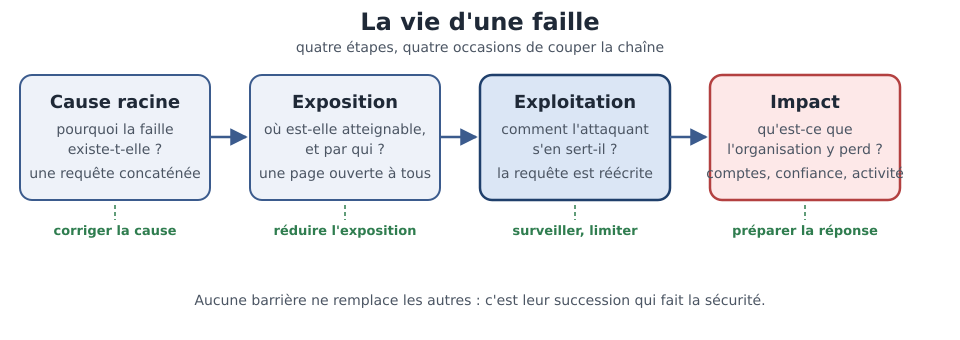

[Sommaire](Readme.md) · [Chapitre suivant →](02-owasp-injections.md)

# Anatomie d'une vulnérabilité — Vie d'une faille

> La fromagerie **DIGICHEESE** (la fromagerie du fil rouge) vient
> de passer en ligne. Son développeur a écrit la recherche produits en une ligne
> de Python. Ça marche, c'est même rapide. Et c'est exactement ça, le problème :
> les failles les plus graves tiennent souvent dans les lignes les plus simples
> à écrire.

**Durée de lecture :** 30 min (noyau exigé, atelier compris) · **Aller plus loin :** +10 min (facultatif, pas exigé pour finir la journée) · **Prérequis :** le chapitre « Pourquoi sécuriser ? »

---

## Objectifs

À l'issue de ce chapitre, vous serez capable de :

- **Retracer** les quatre étapes de la vie d'une faille.
- **Distinguer** une cause racine d'un symptôme.
- **Expliquer** pourquoi corriger le symptôme ne suffit pas.
- **Relier** la gravité d'une faille à son exposition et à son contexte métier.

---

## I. Anatomie d'une faille

En 2011, le service de jeux en ligne de Sony est mis hors service pendant
plusieurs semaines. L'attaque expose 77 millions de comptes : noms, adresses,
courriels, données de paiement. L'origine, selon les rapports de l'époque : une
faille d'injection SQL (Structured Query Language) — une requête construite en
collant ce que l'utilisateur tape, sans jamais le vérifier.

Une seule ligne mal écrite, et tout l'édifice tombe. Il n'y a pas de magie noire
derrière. Une faille a une **vie**, et cette vie suit toujours les mêmes quatre
étapes.

| Étape | La question qu'elle pose | Dans l'histoire de Sony |
| --- | --- | --- |
| **Cause racine** | Pourquoi la faille existe-t-elle ? | une requête écrite par concaténation |
| **Exposition** | Où est-elle atteignable, et par qui ? | une page de recherche ouverte à tous |
| **Exploitation** | Comment l'attaquant s'en sert-il ? | il fait réécrire la requête avec ses propres critères |
| **Impact** | Qu'est-ce que l'organisation y perd ? | des comptes, de la confiance, des semaines d'activité |

*Chaque étape est une occasion de couper la chaîne : corriger la cause, réduire l'exposition, surveiller, préparer la réponse.*

L'intérêt de ces quatre étapes, c'est qu'elles se coupent à plusieurs endroits.
Une requête paramétrée supprime la cause racine. Un filtre en amont réduit
l'exposition. Une surveillance réduit la durée de l'exploitation. Une procédure
de crise réduit l'impact. **Aucune de ces barrières ne remplace les autres** :
c'est leur succession qui fait la sécurité.

> 🧪 **Atelier rapide (5 min)**
>
> Un formulaire d'inscription n'a pas de captcha : un script peut y créer des
> comptes par milliers. Retrouvez les quatre étapes de cette faille : cause
> racine, exposition, exploitation, impact. Une ligne par étape suffit.

---

## II. Cause racine ou symptôme ?

La fromagerie DIGICHEESE constate que sa recherche produits renvoie tout le
catalogue dès qu'on y tape une apostrophe. L'équipe est pressée. Trois
correctifs sont sur la table :

- bloquer les requêtes qui contiennent une apostrophe ;
- afficher une page d'erreur neutre, sans détail technique ;
- écrire la requête avec des paramètres, au lieu de coller les chaînes.

Le premier traite le **symptôme** : il cache un cas précis, et il en bloquera
d'autres — dont des clients qui cherchent un cœur de Comté ou l'ami du fromager.
Le deuxième traite aussi un symptôme : il empêche l'attaquant de lire l'erreur,
pas d'agir. Le troisième traite la **cause racine** : la requête ne mélange plus
les données et les instructions.

Retenez la question : **si je corrige cela, la faille peut-elle encore être
exploitée autrement ?** Si la réponse est oui, vous traitez un symptôme.

---

## III. Gravité et exposition

Toutes les failles ne se valent pas. Une faille critique sur un poste isolé, sans
réseau, peut être moins grave qu'une faille moyenne sur la page de paiement d'un
site fréquenté.

Deux notions permettent d'y voir clair :

- la **surface d'attaque** : ce qui est joignable de l'extérieur, et par qui. Une
  page ouverte à tous les visiteurs n'a pas la même exposition qu'un outil interne
  réservé à l'équipe ;
- le **contexte métier** : ce qui est derrière. Les données de paiement, les
  dossiers patients ou les comptes administrateurs n'ont pas la même valeur que le
  texte d'une page vitrine.

Pour classer les failles sans repartir de zéro à chaque fois, l'industrie s'appuie
sur des grilles de notation. La plus répandue est le **CVSS** (Common
Vulnerability Scoring System) : un score qui combine ce que l'attaquant doit faire
pour réussir et ce que l'organisation y perd. Ce score est un **point de départ**,
pas une décision : un score élevé sur un système sans valeur reste à traiter après
un score moyen sur la caisse.

Pour se parler, les professionnels regroupent aussi les failles en familles. La
classification la plus répandue est le Top 10 de l'**OWASP** (Open Web
Application Security Project) : les dix familles de failles web les plus
fréquentes, révisées régulièrement. Ce n'est pas une liste à apprendre par cœur :
c'est une **carte**, celle qui permet de dire « c'est une faille de la famille
A03 » plutôt que « c'est une faille, je ne sais pas laquelle ». Vous la
manipulerez dès l'exercice qui suit, puis famille par famille au fil de la
journée.

### Exercice 1 — Classer des scénarios dans le Top 10 de l'OWASP (25 min)

#### Contexte

La fromagerie **DIGICHEESE** (la fromagerie du fil rouge) vient de mettre sa
boutique en ligne. Six observations ont été remontées, par l'équipe et par des
clients. Aucune n'est encore qualifiée : c'est votre travail.

Pour vous repérer, voici les dix familles du Top 10 de l'OWASP, la classification
de référence des failles web. Vous n'avez pas à les apprendre : vous les utilisez
comme une carte.

| Code | Famille | Ce qu'elle recouvre |
| --- | --- | --- |
| **A01** | Broken Access Control | faire ce qu'on n'a pas le droit de faire |
| **A02** | Cryptographic Failures | des données mal protégées, chiffrées mal ou pas |
| **A03** | Injection | confondre les données et les instructions |
| **A04** | Insecure Design | un choix de conception dangereux, pas un bug |
| **A05** | Security Misconfiguration | réglages par défaut, debug laissé actif, pages inutiles |
| **A06** | Vulnerable and Outdated Components | une dépendance connue pour être fragile |
| **A07** | Identification and Authentication Failures | des comptes et des mots de passe mal protégés |
| **A08** | Software and Data Integrity Failures | des mises à jour ou des données jamais vérifiées |
| **A09** | Security Logging and Monitoring Failures | ne pas voir l'attaque arriver |
| **A10** | **SSRF** (Server-Side Request Forgery) | faire demander au serveur ce qu'il ne devrait pas |

##### Les six observations

1. **La recherche produits.** La requête envoyée à la base est construite en
   collant ce que le visiteur tape. En saisissant `' OR '1'='1`, on obtient la
   liste complète du catalogue, y compris les produits non publiés.
2. **Les commentaires clients.** Un commentaire s'affiche tel quel sur la fiche
   produit. Un visiteur y dépose une balise de script qui s'exécute dans le
   navigateur de quiconque lit la fiche.
3. **L'espace administration.** L'adresse `/admin/users` renvoie la liste des
   comptes clients. Un client connecté qui la tape dans son navigateur l'obtient,
   sans être administrateur.
4. **La configuration.** Le serveur tourne en mode debug. L'adresse
   `/debug/config` affiche les identifiants de la base de données.
5. **La génération de factures.** Les factures sont produites par une bibliothèque
   vieille de plusieurs années, dont une faille de contournement est publiquement
   documentée.
6. **Le formulaire de connexion.** Aucune limite de tentatives, aucun blocage après
   plusieurs essais ratés.

---

#### Consignes

##### Partie 1 — Rattacher chaque observation à une famille

Pour chacune des six observations, donnez le **code** de la famille (A01, A03…) et
son nom. Une observation peut relever de plusieurs familles : dans ce cas, donnez
la principale et citez l'autre en une phrase.

##### Partie 2 — Retracer l'anatomie de l'une de ces failles

Choisissez l'observation qui vous semble la plus grave. Retrouvez ses quatre
étapes : **cause racine**, **exposition**, **exploitation**, **impact**. Une phrase
par étape.

##### Partie 3 — Cause racine ou symptôme ?

Pour l'observation 4 (le mode debug laissé actif en production), l'équipe propose
trois correctifs :

- désactiver le mode debug sur le serveur de production ;
- bloquer l'adresse `/debug/config` dans le pare-feu ;
- afficher une page d'erreur neutre à la place.

Dites, pour chacun, s'il traite la **cause racine** ou un **symptôme**, et
justifiez en une phrase.

##### Partie 4 — Traiter en premier

Parmi les six observations, laquelle traitez-vous en premier ? Justifiez en deux
lignes en vous appuyant sur l'**exposition** et le **contexte métier**.

---

#### ✅ Auto-évaluation

Avant de passer au corrigé, vérifiez que :

- [ ] J'ai classé **les six** observations, et pas seulement les évidentes.
- [ ] Mon classement donne le **code** de la famille (A01, A03…), pas seulement son
      nom.
- [ ] Pour l'anatomie, j'ai donné les **quatre étapes**, y compris l'impact.
- [ ] J'ai distingué, pour les trois correctifs, ce qui traite la **cause racine**
      de ce qui traite le **symptôme**.
- [ ] Mon choix de priorité s'appuie sur un **critère explicite** (exposition,
      contexte métier, personnes touchées…).

---

#### Prolongement de l'exercice

*Facultatif.* Reprenez l'observation 2 (les commentaires clients). Que change le
fait que la faille s'exécute dans le navigateur d'un administrateur plutôt que dans
celui d'un client ? Reformulez l'impact en conséquence.

Voir la correction

> Comparez d'abord votre travail aux **étapes** ci-dessous : la méthode compte autant que le résultat. Les familles citées sont celles du Top 10 de l'**OWASP** (Open Web Application Security Project).

#### Partie 1 — Rattacher chaque observation à une famille

**Éléments attendus :**

| Observation | Famille | Pourquoi |
| --- | --- | --- |
| La recherche produits | **A03** — Injection | la saisie est traitée comme une instruction |
| Les commentaires clients | **A03** — Injection | même confusion, dans le navigateur : le texte saisi devient du code |
| L'espace administration | **A01** — Broken Access Control | l'accès n'est pas vérifié côté serveur |
| La configuration | **A05** — Security Misconfiguration | un réglage de développement laissé actif en production |
| La génération de factures | **A06** — Vulnerable and Outdated Components | une dépendance connue pour être fragile, jamais mise à jour |
| Le formulaire de connexion | **A07** — Identification and Authentication Failures | rien ne protège le compte au-delà du mot de passe |

**Ce qu'il faut retenir :** deux observations relèvent de la même famille. La
classification ne se lit pas comme une étiquette par faille : une seule famille
peut couvrir des mécanismes très différents. Ici, la confusion entre les données et
les instructions se retrouve dans la recherche comme dans les commentaires — la
seconde s'exécutant dans le navigateur plutôt que dans la base.

**Erreurs fréquentes :** classer les commentaires clients dans une famille à part,
parce que « ça ne touche pas la base de données ». Ce qui compte, c'est le
mécanisme — des données confondues avec des instructions — pas la syntaxe.

---

#### Partie 2 — Retracer l'anatomie de l'une de ces failles

**Éléments attendus** (exemple avec la recherche produits — toute autre observation
est acceptable, à condition de remplir les quatre étapes) :

| Étape | Ce qui est attendu |
| --- | --- |
| **Cause racine** | la requête est construite en collant la saisie de l'utilisateur, sans séparer les données des instructions |
| **Exposition** | la recherche est ouverte à tous les visiteurs, sans authentification |
| **Exploitation** | l'attaquant saisit une chaîne qui fait réécrire la requête, et obtient la liste complète |
| **Impact** | des produits non publiés deviennent visibles, et la même porte ouvre sur ce que la base contient |

**Ce qu'il faut retenir :** beaucoup décrivent les conséquences (« le catalogue
fuite ») sans remonter à la cause racine. L'anatomie n'est complète que si les
quatre étapes sont là — et l'étape la plus souvent oubliée est la cause racine.

---

#### Partie 3 — Cause racine ou symptôme ?

**Éléments attendus :**

| Correctif | Verdict | Pourquoi |
| --- | --- | --- |
| désactiver le mode debug sur le serveur de production | **cause racine** | la faille disparaît : plus rien n'est exposé par ce canal |
| bloquer l'adresse `/debug/config` dans le pare-feu | **symptôme** | une porte est fermée, mais le mode debug reste actif et peut en ouvrir d'autres |
| afficher une page d'erreur neutre à la place | **symptôme** | on masque l'affichage, pas la configuration |

**Ce qu'il faut retenir :** la question à se poser est « si je corrige cela, la
même configuration peut-elle encore exposer autre chose ? ». Si la réponse est oui,
vous traitez un symptôme.

---

#### Partie 4 — Traiter en premier

**Éléments attendus** (classement indicatif — l'important est le critère explicite) :

Pour **DIGICHEESE** (la fromagerie du fil rouge), deux réponses se défendent :

- **la configuration** en premier, si l'on juge sur l'exposition : un identifiant
  de base de données ouvre tout le reste, et l'adresse est accessible sans
  authentification ;
- **la recherche produits** en premier, si l'on juge sur le nombre de personnes
  touchées : c'est la page que tout le monde utilise.

Ce qui est attendu, c'est que le critère soit **dit** : un classement sans critère
affiché ne se discute pas.

---

#### Points à retenir

- Classer, c'est donner un **nom commun** à un problème : le code de famille suffit
  à se comprendre entre collègues.
- Une même famille peut couvrir des mécanismes très différents — la confusion entre
  données et instructions se retrouve dans la recherche comme dans les commentaires.
- L'anatomie d'une faille se décrit en quatre étapes, et se coupe à chacune d'elles.
- Un correctif qui traite un symptôme donne l'impression d'avancer : seule la cause
  racine rend l'attaque impossible à rejouer autrement.
- Un classement de priorité n'a de valeur que si son **critère est explicite**.

---

## IV. Aller plus loin

*Contenu facultatif, pas exigé pour finir la journée : ces approfondissements
ne sont jamais exigés pour terminer le cours.*

- **L'histoire du Top 10 OWASP** : publiée depuis le début des années 2000 et
  révisée plusieurs fois, la liste montre ce qui a changé dans les pratiques de
  développement — par exemple la place prise par les dépendances tierces.
- **ANSSI** (Agence nationale de la sécurité des systèmes d'information) : ses
  guides d'hygiène détaillent, sur un système réel, ce que ce chapitre résume en
  quatre étapes.
- **Les rapports publics sur l'incident de Sony** : ils décrivent la chaîne
  complète, de la faille initiale à la remise en service.

---

## Points clés

- Une faille suit quatre étapes : **cause racine, exposition, exploitation,
  impact** — et la chaîne se coupe à chacune d'elles.
- Corriger un symptôme donne l'impression d'avancer : seule la cause racine rend
  l'attaque impossible à rejouer autrement.
- La gravité dépend de **l'exposition et du contexte métier**, pas de la seule
  complexité technique.
- Les familles de vulnérabilités sont une **carte** pour se parler, pas une liste
  à réciter.

---

## 🧠 Vérifiez vos acquis

*Formatif, jamais noté. Répondez sans relire le chapitre, puis dépliez « Vérifier ses réponses » pour vous corriger : ce qui compte est de repérer où vous vacillez, pas de faire 5 sur 5.*

**1.** Un développeur remplace la concaténation par une requête écrite avec des paramètres, au lieu de coller les chaînes. Quelle étape de la vie de la faille vient-il de supprimer ?

- A. L'exposition : la page de recherche n'est plus joignable de l'extérieur
- B. La cause racine : la requête ne mélange plus les données et les instructions
- C. L'exploitation : l'attaquant ne sait plus écrire une requête
- D. L'impact : les données de paiement n'ont plus de valeur métier

**2.** L'équipe de DIGICHEESE retient un seul correctif : afficher une page d'erreur neutre, sans détail technique. Que traite cette mesure ?

- A. La cause racine, puisque l'erreur disparaît
- B. Un symptôme : elle empêche l'attaquant de lire l'erreur, pas d'agir
- C. Le contexte métier, en retirant les données de paiement de la page
- D. La surface d'attaque, en fermant la page à tous les visiteurs

**3.** Une faille reçoit un score **CVSS** (Common Vulnerability Scoring System) de 9,1 sur un outil interne sans donnée sensible ; une autre, score 5,4, touche la page de paiement du site. Par laquelle commencer, et pourquoi ?

- A. La 9,1 : le score combine ce que l'attaquant doit faire et ce que l'organisation y perd, il fixe donc l'ordre
- B. La 5,4 : le score est un point de départ, et le contexte métier tranche
- C. La 9,1 : un score élevé reste à traiter après un score moyen, c'est la règle
- D. Impossible de trancher : un score CVSS ne dit rien de l'exposition

**4.** Dans le vocabulaire de ce chapitre, à quoi sert le Top 10 de l'**OWASP** (Open Web Application Security Project) ?

- A. À apprendre par cœur les dix failles les plus fréquentes, dans l'ordre de gravité, pour les corriger une à une
- B. À chiffrer la gravité d'une faille pour un système donné, en combinant ce que l'attaquant fait et ce que l'organisation perd
- C. À regrouper les familles de failles web les plus fréquentes, pour pouvoir dire « c'est une faille de la famille A03 »
- D. À interdire les habitudes de programmation les plus risquées, en publiant une liste de pratiques à bannir en revue de code

**5.** *Question ouverte (2-3 lignes).* Le chapitre donne une question pour distinguer cause racine et symptôme : « si je corrige cela, la faille peut-elle encore être exploitée autrement ? ». Appliquez-la au blocage des requêtes contenant une apostrophe : que répond-on, et que faut-il en conclure ?

---

Vérifier ses réponses

### Réponses

**1. B.** Écrire la requête avec des paramètres supprime la cause racine : les données et les instructions ne passent plus par le même chemin.
**Pourquoi :** les trois autres mesures agissent ailleurs — un filtre en amont réduit l'exposition, une surveillance réduit la durée de l'exploitation, une procédure de crise réduit l'impact. Aucune ne remplace la correction de la cause.

**2. B.** La page d'erreur neutre cache un symptôme : l'attaquant ne lit plus le détail technique, mais la faille reste exploitable.
**Pourquoi :** la question du chapitre se pose ici — la faille peut encore être exploitée autrement, donc le correctif ne traitait pas la cause.

**3. B.** Un score élevé sur un système sans valeur se traite après un score moyen sur la caisse : le contexte métier et l'exposition décident.
**Pourquoi :** le CVSS est présenté comme un point de départ, pas une décision — la gravité dépend de l'exposition et du contexte métier, pas de la seule complexité technique.

**4. C.** C'est une carte pour se parler : elle nomme la famille plutôt que de laisser la faille anonyme.
**Pourquoi :** le chapitre insiste — ce n'est ni une liste à réciter ni une grille de notation ; la notation, c'est le rôle du CVSS.

**5.** Attendu : oui, la faille reste exploitable — l'apostrophe n'est qu'un cas particulier, et le blocage en punira d'autres (un client qui cherche un cœur de Comté). Conclusion attendue : on traitait un symptôme, il faut reprendre la requête elle-même avec des paramètres.
**Pourquoi :** seule la cause racine rend l'attaque impossible à rejouer autrement ; masquer ou filtrer un cas précis donne seulement l'impression d'avancer.

---

[Sommaire](Readme.md) · [Chapitre suivant →](02-owasp-injections.md)
