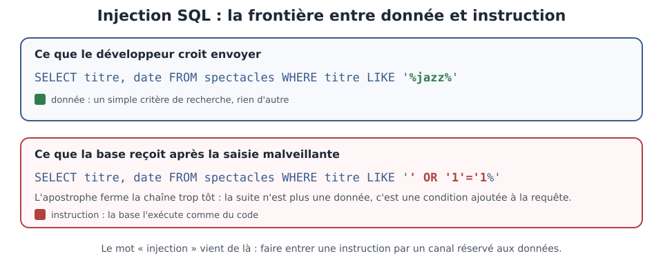

[← Chapitre précédent](01-anatomie-vulnerabilite.md) · [Sommaire](Readme.md) · [Chapitre suivant →](03-owasp-web.md)

# Les injections — quand les données deviennent des instructions

> `' OR '1'='1` — sept caractères, et la base de données renvoie tout ce qu'elle
> contient. Ce n'est pas de la magie, c'est de la grammaire : la requête envoyée
> par l'application a été **réécrite** par celui qui saisit le formulaire.

**Durée de lecture :** 40 min (noyau exigé, atelier compris) · **Aller plus
loin :** +30 min (facultatif, pas exigé pour finir la journée) · **Prérequis :**
le chapitre « Anatomie d'une vulnérabilité »

---

## Objectifs

À l'issue de ce chapitre, vous serez capable de :

- **Expliquer** ce qui distingue une donnée d'une instruction dans une requête.
- **Identifier** une injection dans un extrait de code Python, SQL ou de commande
  système.
- **Relier** chaque injection à sa cause racine : concaténation de chaînes,
  validation absente.
- **Choisir** la barrière qui coupe réellement la chaîne d'attaque, et dire
  pourquoi les autres ne suffisent pas.

---

## I. Le principe — des données qui deviennent des instructions

Une plateforme de billetterie met en ligne la recherche de ses spectacles. Le
développeur a écrit la fonctionnalité en quelques lignes, avec Python et une base
**SQL** (Structured Query Language) :

```python
# Recherche de spectacles — la requête est construite en collant la saisie
requete = f"SELECT titre, date FROM spectacles WHERE titre LIKE '%{recherche}%'"
curseur.execute(requete)
```

Tant que le visiteur tape « jazz », tout va bien. La requête envoyée à la base
ressemble à ceci :

```sql
SELECT titre, date FROM spectacles WHERE titre LIKE '%jazz%'
```

Le mot « jazz » est une **donnée** : un critère de recherche, rien d'autre. Mais
il est arrivé dans la requête par concaténation — le même chemin que les mots
`select`, `from`, `where`, qui sont des **instructions**. La base de données, elle,
ne fait pas la différence entre les deux : elle reçoit une chaîne et l'exécute
comme un programme.

Un visiteur malveillant saisit donc ceci dans le champ de recherche :

```text
' OR '1'='1
```

La requête devient :

```sql
SELECT titre, date FROM spectacles WHERE titre LIKE '%' OR '1'='1%'
```

L'apostrophe fermée la chaîne du motif de recherche trop tôt. Ce qui suit n'est
plus une donnée : c'est une **condition** ajoutée à la requête. Or
`titre like '%'` est vraie pour chaque spectacles dont le titre n'est pas vide —
le filtre a disparu, la liste complète s'affiche, y compris les représentations
non publiées.

| Nature | Rôle | Exemples dans la requête |
| --- | --- | --- |
| **Instructions** | ce que la base exécute | `select`, `from`, `where`, `like` |
| **Données** | ce que la base compare | `jazz`, un prix, une date, un nom |

Le mot « injection » vient de là : faire entrer une **instruction** par un canal
réservé aux **données**.



*La requête prévue ne contient qu'une donnée ; après la saisie malveillante, la base reçoit une condition qu'elle exécute.*

> [!DANGER]
> La cause racine n'est pas « l'attaquant a trouvé une astuce ». C'est la
> concaténation : dès qu'une saisie est collée dans un programme, elle peut
> devenir du code.

> 🧪 **Atelier rapide (8 min)**
>
> Dans le lab fourni, le service `vulnerable` expose une recherche produits
> volontairement fragile. Après `cd lab` puis `docker compose up --build -d`,
> comparez deux requêtes :
>
> ```bash
> curl "http://localhost:8080/products/search?q=comte"
> curl "http://localhost:8080/products/search?q=' OR '1'='1"
> ```
>
> Notez ce qui change entre les deux réponses : combien de produits, lesquels.
> Reformulez en une phrase ce que la seconde requête a fait **écrire** à la base.

---

## II. Un même mécanisme, trois syntaxes

Le principe ne se limite pas à SQL. Partout où une application assemble du texte
puis le fait interpréter, la même confusion est possible.

### Injection SQL

La plus fréquente, la plus documentée. Elle se glisse dans une recherche, un
formulaire de connexion, un tri de tableau — partout où une saisie rejoint une
requête. Au-delà de la lecture, une injection peut permettre la modification ou
la suppression de données, selon les droits du compte utilisé par l'application.

### Injection NoSQL

Les bases **NoSQL** (Not only SQL) — MongoDB et consœurs — interrogent les données
avec des documents JSON (JavaScript Object Notation) plutôt qu'avec du texte SQL.
Le mécanisme reste le même : si l'application recopie la saisie dans la requête,
l'attaquant n'envoie plus une valeur mais un **opérateur**. L'opérateur `$ne`
(« différent de ») transforme alors une recherche de compte en « n'importe quel
client » : le premier compte de la base convient. Pas de SQL, pas d'apostrophe —
mais la même confusion entre la donnée attendue et l'instruction exécutée.

> ⚠️ **À ARBITRER** — suppression envisagée : le détail de la famille NoSQL
> (opérateur `$ne`). Si le volume doit encore baisser, la ligne « NoSQL » du
> tableau de synthèse qui suit suffit : le mécanisme est déjà établi avec SQL.
> L'exemple complet est repris en « Aller plus loin ».

### Injection de commandes

Quand une application dialogue avec le système d'exploitation, la confusion
devient exécution de programmes.

```python
# Vérification de disponibilité d'un hôte — la saisie rejoint une commande shell
os.system("ping -c 1 " + hote)
```

Un hôte saisi comme `127.0.0.1; whoami` fait exécuter une seconde commande après
le ping. Ici, ce n'est même plus une requête qui est réécrite : c'est la ligne de
commande elle-même.

| Famille | Ce qui est interprété | Ce que l'attaquant injecte |
| --- | --- | --- |
| SQL | la requête envoyée à la base | une condition, une clause supplémentaire |
| NoSQL | le document de recherche | un opérateur (`$ne`, `$gt`, `$where`) |
| Commandes | la ligne passée au système | une seconde commande, un séparateur |

> [!WARNING]
> Les trois cas se ressemblent parce qu'ils partagent une cause racine
> identique : une chaîne de caractères assemble du code et des données, puis
> l'ensemble est interprété. Cherchez la cause, pas la syntaxe.

---

## III. Causes racines et barrières

### Ce qui fabrique une injection

Deux habitudes suffisent, et elles sont prises dans des projets pressés tous les
jours :

1. **La concaténation.** Interpoler une variable dans une chaîne — littéraux
   Python, `format()`, simple addition — puis envoyer le résultat à un
   interpréteur. C'est le point de départ de presque toutes les injections.
2. **L'absence de validation.** Une saisie qui n'est jamais examinée peut
   contenir ce que l'attaquant veut. Mais attention : valider n'est pas
   corriger, on va le voir.

### Les barrières qui ne traitent qu'un symptôme

L'équipe de la billetterie propose trois correctifs après l'incident :

- bloquer les requêtes qui contiennent une apostrophe ;
- ajouter un pare-feu applicatif qui rejette les motifs suspects ;
- afficher une page d'erreur neutre, sans détail technique.

Le premier casse la recherche de « soirée jazz à l'Olympia » et celle de
« Colette » — les clients légitimes sont les premières victimes, et l'attaquant
remplace l'apostrophe par un encodage différent. Le deuxième filtre les formes
connues ; une forme inédite passe. Le troisième masque l'erreur, pas la faille.
Ces trois mesures ont leur utilité en **défense en profondeur**, mais aucune ne
supprime la cause racine.

### Les barrières qui traitent la cause racine

- **La requête paramétrée** (aussi appelée requête préparée) : la requête est
  envoyée une fois pour toutes, avec des emplacements réservés ; les saisies
  arrivent ensuite, **à part**, et sont toujours traitées comme des données. La
  base ne peut plus les lire comme des instructions.

  ```python
  # La requête et les données voyagent séparément
  curseur.execute(
      "SELECT titre, date FROM spectacles WHERE titre LIKE ?",
      (f"%{recherche}%",),
  )
  ```

- **Les API d'échappement ou les bibliothèques qui paramètrent** : un ORM
  (Object-Relational Mapping) ou un constructeur de requêtes qui sépare les
  valeurs du texte, à condition de l'utiliser sans reconstruire la requête
  soi-même.
- **La liste autorisée** (allow-list) : pour un tri, un code pays, un identifiant
  de module, n'accepter que les valeurs connues — il n'y a alors rien à
  échapper.
- **Les commandes sans shell** : passer les arguments sous forme de liste, un par
  un, au lieu d'assembler une ligne de commande.
- **La réduction des droits** : le compte de base utilisé par l'application n'a
  pas besoin de supprimer des tables. Cela ne supprime pas l'injection, mais
  limite ce qu'elle coûte.

> [!TIP]
> La question à se poser devant chaque ligne qui assemble du texte : « ce que
> l'utilisateur tape peut-il être lu comme une instruction ? ». Si oui, la ligne
> est à reprendre — quel que soit le langage.

La mise en œuvre complète de ces correctifs — paramétrage, ORM, tests
d'injection — est traitée dans la partie « sécuriser le code » du parcours. Ici,
l'objectif est de **voir** la faille : la reconnaissance précède la réparation.

---

## IV. Aller plus loin

*Contenu facultatif, pas exigé pour finir la journée : ces approfondissements
ne sont jamais exigés pour terminer le cours.*

- **L'exemple NoSQL complet** : la connexion qui recopie la saisie, et le corps
  de requête qui devient un opérateur.

  ```python
  # Connexion d'un client — la saisie est recopiée telle quelle dans la requête
  requete = {"email": corps_json["email"]}
  client = db.clients.find_one(requete)
  ```

  ```json
  {"email": {"$ne": ""}}
  ```

- **Les outils d'automatisation** : `sqlmap` et ses équivalents testent
  automatiquement des centaines de variantes d'injection. Ils sont utiles pour
  vérifier **son propre** lab ou une application dont on est responsable ; les
  lancer contre un système tiers est illégal et dangereux. Le lab de ce cours est
  le seul terrain de jeu prévu.
- **Le pare-feu applicatif** — **WAF** (Web Application Firewall) : il filtre le
  trafic entrant selon des motifs connus. C'est une couche utile, mais elle joue
  sur l'exposition, pas sur la cause racine — une injection qu'il ne reconnaît
  pas traverse.
- **Les injections de second ordre** : la saisie est stockée sans dommage, puis
  concaténée plus tard dans une autre requête — un export, une tâche de nuit, un
  rapport. La validation à l'entrée ne protège pas ce second usage.

---

## Points clés

- Une injection naît d'une **confusion** : une donnée est traitée comme une
  instruction, parce que les deux empruntent le même chemin.
- Le mécanisme est le même en SQL, en NoSQL et en commandes système — seule la
  syntaxe change.
- Les causes racines tiennent en deux habitudes : **concaténation** et **absence
  de validation**.
- Bloquer des motifs, filtrer ou masquer les erreurs traite des symptômes ; la
  **requête paramétrée** supprime la confusion, donc la faille.
- Réduire les droits du compte de base ne corrige pas l'injection, mais réduit
  ce qu'elle coûte.

---

[← Chapitre précédent](01-anatomie-vulnerabilite.md) · [Sommaire](Readme.md) · [Chapitre suivant →](03-owasp-web.md)
