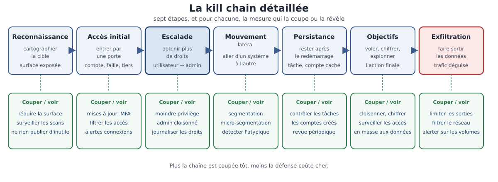

[← Chapitre précédent](07-modeles-attaquant.md) · [Sommaire](Readme.md) · [Chapitre suivant →](09-cve-et-course.md)

# La kill chain — Une attaque en sept étapes

> En 2013, la chaîne de compromission d'un grand distributeur américain
> commence par un fournisseur de climatisation : un accès prestataire, puis un
> accès au réseau interne, puis le vol de dizaines de millions de cartes de
> paiement. Chaque étape de cette chaîne laissait une occasion de l'arrêter.
> Une attaque réussie n'est presque jamais un coup de génie : c'est une série
> d'échecs de défense qui s'enchaînent.

**Durée de lecture :** 35 min (noyau exigé, atelier compris) · **Aller plus
loin :** +15 min (facultatif, pas exigé pour finir la journée) · **Prérequis :**
le chapitre « Modèles d'attaquant »

---

## Objectifs

À l'issue de ce chapitre, vous serez capable de :

- **Décrire** les étapes d'une chaîne de compromission, de la reconnaissance à
  l'exfiltration.
- **Situer** une étape d'attaque dans la kill chain à partir d'un scénario
  réel.
- **Associer** à chaque étape la mesure de défense qui la coupe.
- **Expliquer** pourquoi plusieurs échecs doivent s'enchaîner pour qu'un
  incident grave ait lieu.

---

## I. La chaîne

Le terme **kill chain** (« chaîne d'élimination ») vient du vocabulaire
militaire : il décrit la succession d'étapes nécessaires pour atteindre une
cible. En sécurité informatique, on parle aussi de **chaîne de compromission**.
Son intérêt est simple : une attaque réussie n'est pas un événement, c'est un
**processus**, et un processus se coupe à plusieurs endroits.

Les étapes classiques, dans l'ordre :

| Étape | La question qu'elle pose | Exemple concret |
| --- | --- | --- |
| **Reconnaissance** | Que vaut la cible, et comment y entrer ? | balayage des adresses, recherche d'adresses de courriel publiques |
| **Accès initial** | Par quelle porte on entre ? | un compte prestataire oublié, une faille d'une bibliothèque obsolète |
| **Escalade de privilèges** | Comment obtenir plus de droits ? | un compte utilisateur transformé en compte d'administration |
| **Mouvement latéral** | Où aller ensuite dans le réseau ? | d'un poste de travail vers le serveur de fichiers |
| **Persistance** | Comment rester après le redémarrage ? | une tâche planifiée, un compte créé en douce |
| **Actions sur les objectifs** | Ce que l'attaquant est venu faire | vol de données, chiffrement rançongiciel, espionnage |
| **Exfiltration** | Comment faire sortir les données ? | un transfert vers un stockage en ligne, déguisé en trafic normal |

Deux précisions sur ce vocabulaire. L'**accès initial** est souvent la partie la
plus médiatisée (« une faille a été exploitée »), alors que les étapes
suivantes — escalade, mouvement, persistance — sont celles qui transforment un
incident mineur en catastrophe. Et l'**exfiltration** est l'étape la plus
discrète : les données sortent parfois pendant des semaines, à petites doses,
dans un trafic qui ressemble à n'importe quelle sauvegarde.

> [!INFO]
> Toutes les attaques ne remplissent pas les sept étapes. Un vol de mot de
> passe réutilisé peut aller de l'accès initial à l'action finale en quelques
> minutes. La kill chain n'est pas un scénario à suivre : c'est une **grille de
> lecture** pour savoir où l'on se trouve.

> 🧪 **Atelier rapide (5 min)**
>
> Reprenez l'affaire du distributeur évoquée en introduction, et placez chacun
> de ces faits sur la kill chain :
>
> - les coordonnées du prestataire de maintenance sont récupérées ;
> - le réseau interne du distributeur est atteint depuis le réseau du prestataire ;
> - les droits d'un compte sont élargis pour atteindre les serveurs de caisse ;
> - les numéros de cartes sont copiés depuis les terminaux de paiement ;
> - les données sortent du réseau pendant plusieurs jours.

---

## II. Où couper la chaîne

L'intérêt pratique de la kill chain apparaît dès qu'on la lit à l'envers :
**pour chaque étape, il existe une mesure qui l'empêche ou qui la révèle**. Et
plus on coupe tôt, moins ça coûte cher.

| Étape | Couper (prévenir) | Voir (détecter) |
| --- | --- | --- |
| Reconnaissance | réduire la surface exposée, ne rien publier d'inutile | surveillance des balayages, pages pièges |
| Accès initial | mises à jour, authentification forte, filtrage des accès distants | alertes sur les connexions inhabituelles |
| Escalade de privilèges | moindre privilège, comptes d'administration cloisonnés | journalisation des changements de droits |
| Mouvement latéral | segmentation du réseau, micro-segmentation | détection des connexions internes atypiques |
| Persistance | contrôle des tâches planifiées et des comptes créés | revue périodique des comptes et des services |
| Actions sur les objectifs | cloisonnement et chiffrement des données sensibles | surveillance des accès en masse aux données |
| Exfiltration | limitation des volumes sortants, filtrage réseau | alerte sur les transferts volumétriques inhabituels |

*Chaque étape peut être coupée ou révélée : la colonne du bas donne la mesure de défense correspondante.*

Le cas du distributeur de 2013 l'illustre : un accès distant limité, ou une
segmentation entre le réseau du fournisseur et le réseau interne, aurait coupé
la chaîne à sa deuxième étape.

Deux idées à retenir ici.

**La défense en profondeur** n'est pas un empilement de produits : c'est la
présence d'au moins une barrière à **chaque** étape de la chaîne. Une barrière
unique, même excellente, cède dès qu'elle est contournée.

**La détection vaut la prévention** quand on ne peut pas empêcher. Un accès
prestataire est parfois nécessaire à l'activité : on ne peut pas toujours le
supprimer. En revanche, on peut savoir qu'il a été utilisé, quand, et pour
aller où — et c'est ce qui transforme une compromission silencieuse en incident
géré.

> [!TIP]
> Pour une application concrète, listez les sept étapes dans un tableau et
> remplissez une seule colonne : « qu'est-ce qui, chez nous, empêche ou révèle
> cette étape ? ». Les cases vides sont votre plan de travail — pas les cases
> remplies.

### Exercice bonus — Modéliser la kill chain d'une fuite de données (libre, facultatif)

#### Contexte

Le réseau de pharmacies **Léonie** consolide ses ventes dans un entrepôt de
données. Des exports quotidiens alimentent un lac de données, une chaîne de
planification exécute les traitements, et un tableau de bord expose les agrégats
aux responsables de région.

Un incident vient d'éclater : des données de programme de fidélité — noms,
adresses, historique d'achats — ont été retrouvées en circulation. Personne ne
sait encore par où elles sont sorties, ni depuis quand. L'équipe technique
dispose de ce qui suit :

- les journaux de la chaîne de planification des traitements ;
- les journaux d'accès au lac de données ;
- les journaux du tableau de bord ;
- les journaux du réseau de l'entreprise.

C'est un **défi** : il n'y a pas de solution unique, et vous travaillez en
autonomie. L'objectif est de produire un modèle défendable, pas de retrouver une
réponse attendue.

---

#### Consignes

##### Partie 1 — Modéliser la kill chain

Retracez la chaîne de compromission plausible de cette fuite, étape par étape,
de la reconnaissance à l'exfiltration. Pour chaque étape, décrivez :

- ce que l'attaquant a **fait**, concrètement, dans ce contexte précis ;
- le **composant** de la plateforme impliqué (exports, lac de données, chaîne de
  planification, tableau de bord, réseau) ;
- ce que l'attaquant a **obtenu**, qui lui sert pour l'étape suivante.

##### Partie 2 — Points de rupture

Pour chaque étape de votre modèle, indiquez la mesure qui l'aurait **coupée** ou
**rendue plus coûteuse**. Précisez pour chacune si elle relève de la prévention
ou de la détection, et à quel moment elle devait être en place — avant
l'incident, bien sûr, mais à quel stade de la vie de la plateforme.

##### Partie 3 — Signaux de détection

Parmi les journaux dont dispose l'équipe, identifiez ceux qui auraient permis de
**voir** l'attaque, et à quelle étape. Pour chacun, formulez le signal recherché
sous la forme d'une règle : « quand X arrive, alerter ».

Terminez par une estimation honnête : à quelle étape pensez-vous que
l'attaque aurait pu être **détectée** avec les journaux existants, et que
manquait-il pour la détecter plus tôt ?

---

#### ✅ Auto-évaluation

Avant de comparer avec le modèle de référence, vérifiez que :

- [ ] Ma kill chain couvre **toutes les étapes**, de la reconnaissance à
      l'exfiltration, sans sauter d'étape.
- [ ] Chaque étape nomme un **composant concret** de la plateforme, pas une
      abstraction.
- [ ] Chaque étape dit ce que l'attaquant **obtient** pour la suivante — c'est
      ce qui fait une chaîne.
- [ ] Mes points de rupture distinguent **prévention** et **détection**.
- [ ] Mes signaux de détection sont formulés comme des **règles**, et je dis à
      quelle étape ils auraient agi.

---

#### Pour aller plus loin

*Facultatif.* Si vous ne deviez retenir qu'**un seul** signal de détection à
installer en premier sur cette plateforme, lequel choisiriez-vous, et pourquoi
celui-là plutôt qu'un autre ? Justifiez en quelques lignes.

Voir la correction

> Un défi n'a pas de solution unique : ce document propose **un** modèle défendable et une grille de vérification, pas une correction pas-à-pas. Comparez votre raisonnement au sien, pas vos réponses mot à mot.

#### Grille de vérification

Avant de lire le modèle, vérifiez votre travail sur ces points — ils valent plus
que la conformité au modèle :

| Ce qui est attendu | Ce qui trahit un modèle fragile |
| --- | --- |
| Une chaîne **continue** : chaque étape produit ce dont la suivante a besoin | une liste d'événements sans lien entre eux |
| Des composants **nommés** (exports, lac, planification, tableau de bord, réseau) | des étapes génériques qui pourraient décrire n'importe quelle entreprise |
| Une exfiltration **décrite** (par quoi, vers où, sous quelle apparence) | « les données ont fuité », sans mécanisme |
| Des ruptures **à chaque étape**, pas seulement à l'entrée | une seule barrière, placée devant |
| Des signaux formulés en **règle** | « surveiller les journaux » |

---

#### Modèle de référence

| Étape | Ce que fait l'attaquant | Composant | Ce qu'il obtient |
| --- | --- | --- | --- |
| Reconnaissance | relève les accès exposés et les technologies employées, à partir de ce qui est publiquement visible | réseau, tableau de bord | la carte des points d'entrée |
| Accès initial | utilise un accès distant mal fermé ou un compte de service dont les identifiants ont fuité | réseau, exports | un point d'appui dans le périmètre |
| Escalade de privilèges | élève ses droits pour atteindre les traitements, en exploitant un compte de service trop privilégié | chaîne de planification | la capacité à lancer ou modifier des traitements |
| Mouvement latéral | passe du poste ou du service compromis vers le stockage de données | lac de données | un accès aux données brutes |
| Persistance | crée un compte ou une tâche planifiée qui rejouera l'accès | chaîne de planification | un retour sans nouvelle intrusion |
| Actions sur les objectifs | sélectionne les données de fidélité, parfois en copiant d'abord dans un espace intermédiaire | lac de données | les données visées, rassemblées |
| Exfiltration | sort les données par un canal qui ressemble à un flux normal — un export planifié, une sauvegarde, un transfert sortant | exports, réseau | la fuite effective |

**Ce qu'il faut retenir :** la plateforme data multiplie les **comptes de
service** et les **transferts automatisés** — deux qualités qui sont aussi les
deux meilleures alliées d'un attaquant. Un transfert de données y est un geste
normal, ce qui rend l'exfiltration difficile à distinguer d'un traitement
légitime. C'est là que la modélisation prend tout son sens : elle oblige à
demander, pour chaque étape, « qu'est-ce qui, ici, ressemble à une activité
normale ? ».

---

#### Points de rupture

| Étape | Mesure | Prévention ou détection |
| --- | --- | --- |
| Reconnaissance | ne laisser aucun accès ni aucune information technique exposés inutilement | prévention |
| Accès initial | fermer les accès distants inutiles, authentification forte sur les comptes de service, rotation des identifiants | prévention |
| Escalade | droits minimaux sur les comptes de traitement : un job n'a pas besoin d'administrer la plateforme | prévention |
| Mouvement latéral | cloisonner le lac de données du reste du réseau, accès nominatifs plutôt que partagés | prévention |
| Persistance | revue périodique des comptes et des tâches planifiées, alerte sur toute création | détection |
| Actions sur les objectifs | journaliser les lectures de tables sensibles, plafonner les volumes consultés | détection |
| Exfiltration | plafonner et justifier les volumes sortants, alerter sur un transfert hors habitude | détection |

**Ce qu'il faut retenir :** les mesures de prévention tiennent dans la
conception de la plateforme — droits, cloisonnement, identifiants. Les mesures
de détection, elles, portent sur les **gestes répétés** : lecture de table,
transfert, création de tâche. Une plateforme data se protège donc autant par son
architecture que par sa surveillance.

---

#### Signaux de détection

Modèle de règles, à partir des journaux disponibles :

- **journaux de planification** — « quand une tâche est créée ou modifiée hors
  d'une fenêtre de déploiement connue, alerter » ; « quand un traitement lit une
  table qu'il ne lit jamais, alerter » ;
- **journaux du lac de données** — « quand un compte lit un volume hors de son
  habitude, alerter » ; « quand un compte accède à une table de données
  personnelles pour la première fois, alerter » ;
- **journaux du tableau de bord** — « quand un compte exporte plus que son
  périmètre habituel, alerter » ;
- **journaux réseau** — « quand un transfert sortant dépasse le volume habituel
  d'une sauvegarde, alerter ».

**Sur la détection précoce :** avec les journaux existants, l'attaque devient
probablement visible au stade des **actions sur les objectifs** — les lectures
de la table de fidélité y sont traçables. Ce qui manque le plus souvent, c'est
la **comparaison à une habitude** : un journal qui enregistre les accès sans
dire lesquels sont inhabituels oblige l'analyste à tout relire. La mesure la
plus rentable est donc souvent un travail de fond — établir ce qui est normal,
pour pouvoir signaler ce qui ne l'est pas.

**Ce qu'il faut retenir :** la question « à quelle étape aurions-nous vu ? » est
plus utile que « avions-nous des journaux ? ». Elle transforme l'audit de
journalisation en évaluation de détection.

---

#### Points à retenir

- Une fuite de données sur une plateforme data suit la kill chain classique, mais
  ses étapes se **dissimulent dans des gestes normaux** : transferts, exports,
  traitements planifiés.
- Les comptes de service et les automatisations sont à la fois la valeur de la
  plateforme et sa surface d'attaque : ils se protègent par des droits minimaux
  et une revue régulière.
- Chaque étape a sa rupture : la prévention tient dans la conception, la
  détection dans la surveillance des gestes répétés.
- Un signal de détection se formule en **règle** — « quand X arrive, alerter » —
  et suppose de savoir ce qui est normal.
- La question qui structure l'exercice : **à quelle étape aurions-nous vu
  l'attaque, et que manquait-il pour la voir plus tôt ?**

---

## IV. Aller plus loin

*Contenu facultatif, pas exigé pour finir la journée : ces approfondissements
ne sont jamais exigés pour terminer le cours.*

- **MITRE ATT&CK** : une base de connaissances publique, maintenue par MITRE (organisme de
  recherche américain), qui recense les modes opératoires observés sur le
  terrain, classés par tactique (l'objectif poursuivi) et par technique (la
  manière). Le sigle ATT (Adversarial Tactics, Techniques) & CK (Common
  Knowledge) en donne le nom complet. Là où la kill chain décrit un déroulé
  général, ATT&CK décrit des gestes précis — par exemple « comment un
  attaquant se fait passer pour un service légitime ». C'est un vocabulaire de
  travail pour les équipes de détection.
- **La chaîne de compromission côté données** : dans un système data (entrepôt,
  lac de données, chaîne de traitement), les étapes sont les mêmes mais les
  portes diffèrent — un compte de service, un accès de stockage, un export
  planifié. La grille de lecture reste valable.
- **Les retours d'expérience publiés** : les rapports d'incident détaillés, publiés par l'ANSSI (Agence nationale de
  la sécurité des systèmes d'information), par les éditeurs ou par les CERT
  (Computer Emergency Response Team), décrivent des chaînes complètes. En lire un en entier
  vaut mieux que dix schémas : on y voit les délais entre chaque étape.

---

## Points clés

- Une attaque réussie est un **processus** en sept étapes — reconnaissance,
  accès initial, escalade, mouvement, persistance, actions sur les objectifs,
  exfiltration — pas un événement isolé.
- La kill chain est une **grille de lecture** : elle sert à se demander, étape
  par étape, où la défense peut agir.
- **Plusieurs échecs doivent s'enchaîner** pour qu'un incident grave ait lieu —
  donc plusieurs occasions existent de l'interrompre.
- Couper tôt coûte moins cher que nettoyer tard : la porte d'entrée est rarement
  l'endroit le plus coûteux de la chaîne.
- Quand on ne peut pas empêcher une étape, on peut presque toujours la
  **détecter** : c'est le rôle des journaux et de la surveillance.

---

## 🧠 Vérifiez vos acquis

*Formatif, jamais noté. Répondez sans relire le chapitre, puis dépliez « Vérifier ses réponses » pour vous corriger : ce qui compte est de repérer où vous vacillez, pas de faire 5 sur 5.*

**1.** Après la prise d'un serveur, un attaquant crée une tâche planifiée et un compte en douce pour survivre au redémarrage. À quelle étape de la **kill chain** est-il ?

- A. Accès initial
- B. Mouvement latéral
- C. Persistance
- D. Actions sur les objectifs

**2.** Des données partent du réseau vers un stockage en ligne, déguisées en trafic de sauvegarde. Quelle étape, et quelle mesure lui est associée dans le chapitre ?

- A. Exfiltration — limitation des volumes sortants et alerte sur les transferts inhabituels
- B. Actions sur les objectifs — cloisonnement et chiffrement des données sensibles
- C. Mouvement latéral — détection des connexions internes atypiques
- D. Reconnaissance — surveillance des balayages et pages pièges

**3.** Comment le chapitre définit-il la défense en profondeur ?

- A. Un empilement de produits de sécurité complémentaires
- B. La présence d'au moins une barrière à **chaque** étape de la chaîne
- C. Une barrière unique, la plus solide possible, sur l'accès initial
- D. Le choix de la détection plutôt que de la prévention

**4.** Un mot de passe réutilisé permet de passer de l'accès initial à l'action finale en quelques minutes, sans escalade ni mouvement latéral. Que conclure ?

- A. Que la grille ne décrit que les attaques longues et ne s'applique pas ici
- B. Que l'attaque est anormale : une chaîne correcte aurait dû remplir les sept étapes, et dans l'ordre
- C. Que la kill chain est une grille de lecture pour savoir où l'on se trouve, pas un scénario à suivre
- D. Que l'escalade de privilèges a forcément eu lieu quelque part, même si rien ne l'indique dans les traces

**5.** *Question ouverte (2-3 lignes).* Dans l'affaire du distributeur de 2013, un accès distant limité ou une segmentation entre le réseau du fournisseur et le réseau interne aurait coupé la chaîne à sa deuxième étape. Expliquez pourquoi couper tôt coûte moins cher, et ce qu'il faut faire d'une étape que l'on ne peut pas empêcher — par exemple un accès prestataire nécessaire à l'activité.

---

Vérifier ses réponses

### Réponses

**1. C.** Tâche planifiée et compte créé en douce servent à rester après le redémarrage : c'est la persistance.
**Pourquoi :** ce sont précisément ces étapes-là — escalade, mouvement, persistance — qui transforment un incident mineur en catastrophe, alors que l'accès initial est le plus médiatisé.

**2. A.** L'exfiltration est l'étape la plus discrète : les données peuvent sortir pendant des semaines, dans un trafic qui ressemble à n'importe quelle sauvegarde.
**Pourquoi :** le tableau associe à chaque étape une mesure qui l'empêche et une qui la révèle — ici, limiter les volumes sortants et alerter sur les transferts volumétriques inhabituels.

**3. B.** Ce n'est pas une question de quantité de produits : une barrière unique, même excellente, cède dès qu'elle est contournée.
**Pourquoi :** plusieurs échecs doivent s'enchaîner pour qu'un incident grave ait lieu — donc plusieurs occasions existent de l'interrompre.

**4. C.** Toutes les attaques ne remplissent pas les sept étapes ; la grille sert à se situer, étape par étape.
**Pourquoi :** c'est une chaîne de compromission, pas un scénario : son intérêt est de montrer où la défense peut agir.

**5.** Attendu : plus on coupe tôt, moins ça coûte cher — la porte d'entrée est rarement l'endroit le plus coûteux de la chaîne, et une segmentation prive l'attaquant de la suite. Pour une étape impossible à empêcher (accès prestataire nécessaire) : la **détecter** — savoir qu'il a été utilisé, quand, et pour aller où.
**Pourquoi :** la détection vaut la prévention quand on ne peut pas empêcher ; c'est ce qui transforme une compromission silencieuse en incident géré.

---

[← Chapitre précédent](07-modeles-attaquant.md) · [Sommaire](Readme.md) · [Chapitre suivant →](09-cve-et-course.md)
