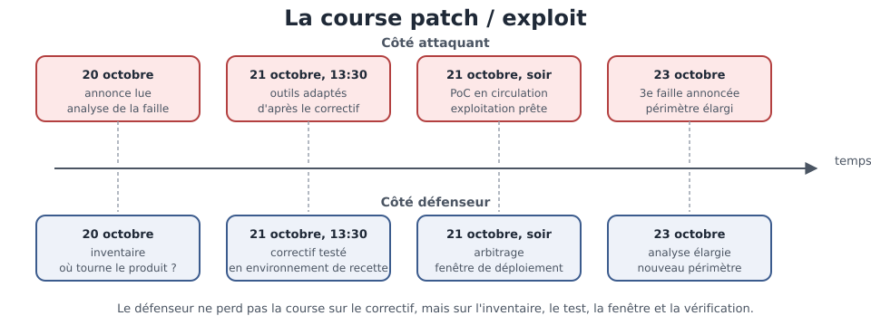

[← Chapitre précédent](08-kill-chain.md) · [Sommaire](Readme.md) · [Chapitre suivant →](10-attaques-appliquees.md)

# Failles connues et course contre la montre — La vie d'une CVE

> **Octobre 2026.** Le 20 octobre, le projet PHP (moteur d'exécution des pages
> web dynamiques) annonce deux failles d'exécution de code à distance non
> authentifiées, notées 9.2 sur l'échelle de gravité CVSS (Common Vulnerability
> Scoring System). Le correctif sort le 21 à 13:30 UTC (heure universelle
> coordonnée). Dans la foulée, des preuves de concept
> circulent publiquement. Le 23 octobre, une troisième faille est annoncée sur
> le même produit. De la publication à l'exploitation massive, il s'écoule
> parfois des heures — parfois des minutes. La question n'est plus « sommes-nous
> concernés ? » mais « en combien de temps le saurons-nous ? ».

**Durée de lecture :** 40 min (noyau exigé, atelier compris) · **Aller plus
loin :** +20 min (facultatif, pas exigé pour finir la journée) · **Prérequis :**
les chapitres « Modèles d'attaquant » et « La kill chain »

---

## Objectifs

À l'issue de ce chapitre, vous serez capable de :

- **Lire** une fiche de vulnérabilité connue et en extraire les informations
  utiles à la décision.
- **Retracer** la course entre publication d'un correctif et exploitation
  d'une faille.
- **Repérer** les étapes où une équipe perd du temps entre l'annonce et le
  déploiement.
- **Organiser** une veille de sécurité proportionnée à un parc applicatif.

---

## I. Anatomie d'une CVE

Le terme **CVE** (*Common Vulnerabilities and Exposures*) désigne un identifiant
unique attribué à une faille connue : `CVE-2024-22195`, par exemple, ne peut
désigner qu'une faille précise, dans un produit précis. Avant l'existence de ce
système, une même faille portait dix noms différents selon les éditeurs — et
deux équipes qui discutaient d'un correctif ne parlaient pas forcément de la
même chose.

Une faille connue se décrit presque toujours dans le même format, appelé
**advisory** (avis de sécurité). Prenons le cas de l'introduction :

| Champ | Ce que dit la fiche |
| --- | --- |
| **Identifiant** | advisory CERT-EU 2026-018, publié par le CERT (Computer Emergency Response Team) européen |
| **Produit** | PHP, le moteur qui exécute les pages web dynamiques |
| **Versions affectées** | les versions antérieures au correctif du 21 octobre |
| **Gravité** | CVSS 9.2 — deux failles d'exécution de code à distance non authentifiées |
| **Annonce** | 20 octobre 2026 |
| **Correctif** | 21 octobre 2026, 13:30 UTC |
| **Preuve de concept** | en circulation dans la foulée du correctif |
| **Suite** | 23 octobre 2026 : une troisième faille est annoncée sur le même produit |

Quatre de ces champs commandent la décision.

Le **produit et les versions affectées** disent si vous êtes concerné — ce qui
suppose de savoir ce qui tourne chez vous. La **gravité** estime ce que
l'attaquant gagne et ce qu'il doit faire : le **CVSS** (*Common Vulnerability
Scoring System*), déjà croisé dans la journée « Vulnérabilités applicatives »,
produit un score de 0 à 10. Une **exécution de code à distance non authentifiée**
signifie qu'un inconnu peut faire tourner ses propres commandes sur le serveur
sans avoir de compte : c'est, avec la divulgation de données, la catégorie la
plus grave. La **date du correctif** donne le point de départ de la course. Et
la mention d'une **preuve de concept** (*PoC*, *proof of concept*) — un script
qui montre que la faille fonctionne — indique que l'exploitation n'est plus
réservée à ceux qui savent la trouver : elle est devenue un produit prêt à
l'emploi.

> [!WARNING]
> Un score CVSS élevé ne dit pas « corrigez tout de suite ». Il dit « cette
> faille permet beaucoup de dégâts ». La priorité réelle combine le score,
> l'exposition de votre système et les données derrière — un serveur interne
> sans accès externe ne se traite pas comme une plateforme publique.

> 🧪 **Atelier rapide (10 min)**
>
> À partir de la fiche ci-dessus (advisory CERT-EU 2026-018), relevez quatre
> informations : le produit concerné, la gravité exprimée, la date et l'heure du
> correctif, puis le délai entre l'annonce et la mise en circulation des preuves
> de concept. Une phrase par information.

---

## II. La course patch / exploit

Entre le moment où une faille est publiée et le moment où elle est massivement
exploitée, deux chronologies se déroulent **en parallèle** — celle de
l'attaquant et celle du défenseur.

| Date | Côté attaquant | Côté défenseur |
| --- | --- | --- |
| 20 octobre | lecture de l'annonce, analyse de la faille | lecture de l'annonce, recherche des systèmes concernés |
| 21 octobre, 13:30 UTC | adaptation des outils à partir du correctif | test du correctif en environnement de recette |
| 21 octobre, fin de journée | preuves de concept en circulation | arbitrage sur la fenêtre de déploiement |
| 23 octobre | nouvelle faille sur le même produit | reprise de l'analyse sur un périmètre élargi |

Le point saillant de ce tableau est le **déséquilibre des durées**. Côté
attaquant, la chaîne est courte : lire l'advisory, adapter un outil existant,
le lancer en masse. Côté défenseur, la chaîne est longue : découvrir qu'on est
concerné, tester que le correctif ne casse rien, obtenir une fenêtre de
déploiement, redémarrer les services, vérifier. Chaque étape est légitime — et
c'est précisément ce qui fait perdre la course.

Là où le défenseur perd du temps, presque toujours :

1. **l'inventaire** : on ne sait pas où tourne le produit concerné ;
2. **le test** : un correctif appliqué sans test peut arrêter un service, et
   personne ne veut porter cette responsabilité seul ;
3. **la fenêtre** : les mises à jour de production se planifient, parfois à
   plusieurs jours d'échéance ;
4. **la vérification** : une fois déployé, encore faut-il confirmer que la
   faille n'est plus exploitable.

Ces quatre étapes se raccourcissent par de la préparation, pas par de
l'urgence : un inventaire à jour, un environnement de test qui ressemble à la
production, une procédure de déploiement d'urgence déjà écrite. C'est le sens
de la notion de **temps de réduction d'exposition** : la mesure qui compte n'est
pas la date du correctif, c'est le délai entre l'annonce et le moment où vos
systèmes ne sont plus exploitables.

*Deux chronologies en parallèle : l'attaquant raccourcit sa chaîne, le défenseur perd du temps sur l'inventaire, le test, la fenêtre et la vérification.*

> [!DANGER]
> Le réflexe le plus coûteux est l'attente : « nous verrons cela au prochain
> lot de mises à jour ». Sur une faille dont la preuve de concept circule, les
> scanners automatisés trouvent les systèmes non corrigés en quelques heures —
> l'attente n'est pas une option neutre, c'est un choix d'exposition.

---

## III. L'effet IA

La course s'est accélérée ces dernières années, des deux côtés : un modèle de
langage produit un script d'exploitation en quelques minutes à partir de la
seule description publique d'une faille et du diff du correctif, là où il
fallait des heures d'analyse — et la même technologie accélère l'analyse du
défenseur, à condition qu'elle s'appuie sur une base saine (inventaire des
dépendances, journaux, procédure). Ce que cet effet impose tient en un mot :
**la veille**. Quand l'exploitation se prépare en minutes, découvrir la faille
au prochain audit trimestriel revient à la découvrir trop tard. Une veille
proportionnée comprend :

- un **abonnement aux avis de sécurité** des produits que vous utilisez (éditeur,
  CERT national, communauté) ;
- un **inventaire automatique des dépendances** — les outils d'analyse de
  composition logicielle — SCA (*Software Composition Analysis*) — listent les
  bibliothèques et leurs versions ;
- une **procédure écrite** pour les correctifs urgents, avec un responsable et
  un délai cible ;
- un **retour d'expérience** après chaque correctif urgent : où a-t-on perdu du
  temps ?

> [!TIP]
> La veille ne sert pas à tout lire : elle sert à être **prévenu** sur ce que
> l'on utilise réellement. Une liste de dix produits suivis vaut mieux qu'un
> flux d'alertes que personne ne traite.

---

## IV. Aller plus loin

*Contenu facultatif, pas exigé pour finir la journée : ces approfondissements
ne sont jamais exigés pour terminer le cours.*

- **L'effet IA en détail** — côté attaquant, la génération de preuves de
  concept est devenue rapide : à partir de la description publique d'une faille
  et du diff du correctif, qui montre exactement la ligne corrigée, un modèle de
  langage produit un script d'exploitation en quelques minutes. Le délai entre
  « la faille est connue » et « l'exploit est disponible » se réduit donc, et
  l'exploitation de masse commence plus tôt. Côté défenseur, la même technologie
  accélère l'analyse : résumer un advisory, identifier les composants concernés
  dans un dépôt de code, proposer le correctif, rédiger le test de
  non-régression.

- **La divulgation responsable** (*coordinated vulnerability disclosure*) : le
  chercheur qui découvre une faille en informe l'éditeur en privé, un délai de
  correction est négocié, et la publication se fait ensuite — correctif et
  description en même temps. Ce délai est exactement ce que la course met sous
  tension : trop court, l'éditeur ne corrige pas ; trop long, la faille finit
  par fuiter.
- **Les bases de référence** : la **NVD** (*National Vulnerability Database*)
  centralise les CVE avec leur score ; les **GHSA** (*GitHub Security
  Advisory*) décrivent les failles de bibliothèques de code ; les CERT
  nationaux publient des advisories commentés, avec des recommandations
  opérationnelles.
- **Le registre des dépendances**, ou SBOM (*software bill of materials*) : la
  liste versionnée de tout ce qui compose une application. C'est le document qui
  transforme la question « sommes-nous concernés ? » en une réponse immédiate.

---

## Points clés

- Une **CVE** est un identifiant unique pour une faille connue ; l'**advisory**
  qui l'accompagne dit le produit, les versions, la gravité et le correctif.
- La course patch / exploit oppose deux chronologies : courte côté attaquant,
  longue côté défenseur — et c'est le **délai d'exposition** qui décide de
  l'issue, pas la date du correctif.
- Le défenseur perd du temps à quatre endroits prévisibles : inventaire, test,
  fenêtre de déploiement, vérification — chacun se prépare avant l'urgence.
- L'IA raccourcit la préparation des exploits comme celle des correctifs : elle
  rend la **veille** obligatoire plutôt qu'optionnelle.
- Une veille proportionnée tient en quatre gestes : s'abonner, inventorier,
  préparer la procédure, faire un retour d'expérience.

---

## 🧠 Vérifiez vos acquis

*Formatif, jamais noté. Répondez sans relire le chapitre, puis cochez. Les réponses sont juste après le séparateur : ce qui compte est de repérer où vous vacillez, pas de faire 5 sur 5.*

**1.** Une fiche annonce une exécution de code à distance non authentifiée notée 9.2 en **CVSS** (Common Vulnerability Scoring System), sur un serveur joignable uniquement depuis le réseau interne. Que dit le chapitre ?

- A. Un score élevé veut dire « corrigez tout de suite », quel que soit le serveur
- B. Le score dit que la faille permet beaucoup de dégâts ; la priorité réelle combine le score, l'exposition du système et les données derrière
- C. Un score ne s'applique qu'aux systèmes exposés sur Internet
- D. Un serveur interne n'a pas à être traité : le score ne veut plus rien dire

- [ ] ✓ je savais

**2.** L'advisory mentionne une **preuve de concept** (*PoC*, *proof of concept*) en circulation. Qu'est-ce que cela change ?

- A. Que l'éditeur a renoncé à publier un correctif
- B. Que l'analyse de la faille reste réservée à ceux qui savent la trouver
- C. Que l'exploitation devient un produit prêt à l'emploi, accessible à qui ne l'aurait pas découverte
- D. Que la faille est déjà corrigée chez tous les éditeurs

- [ ] ✓ je savais

**3.** Le correctif est sorti depuis deux jours et votre service n'est toujours pas à jour. Que manque le plus souvent, d'après les quatre endroits où le défenseur perd du temps ?

- A. Une compétence technique suffisante : les équipes ne savent pas appliquer un correctif
- B. L'inventaire, le test, la fenêtre de déploiement et la vérification — quatre étapes qui se raccourcissent par de la préparation, pas par de l'urgence
- C. Un outil automatique qui déploierait sans test ni fenêtre
- D. De l'urgence : il aurait fallu décider plus vite

- [ ] ✓ je savais

**4.** Le chapitre parle de **temps de réduction d'exposition**. De quoi s'agit-il ?

- A. De la date à laquelle l'éditeur publie le correctif
- B. Du temps que met l'attaquant à adapter son outil après l'annonce
- C. Du délai entre l'annonce et le moment où vos systèmes ne sont plus exploitables
- D. De la durée de l'audit trimestriel de sécurité

- [ ] ✓ je savais

**5.** *Question ouverte (2-3 lignes).* « Une liste de dix produits suivis vaut mieux qu'un flux d'alertes que personne ne traite. » À quoi sert la veille d'après le chapitre, et citez deux des quatre gestes d'une veille proportionnée.

- [ ] ✓ je savais

---

### Réponses

**1. B.** Un score élevé décrit ce que la faille permet, pas ce qu'il faut faire en premier : un serveur interne sans accès externe ne se traite pas comme une plateforme publique.
**Pourquoi :** la priorité réelle combine le score, l'exposition et les données situées derrière — comme pour la gravité d'une faille en général.

**2. C.** Un script qui montre que la faille fonctionne la met à portée de tous : l'exploitation n'est plus réservée à ceux qui savent la trouver.
**Pourquoi :** c'est ce qui raccourcit la course — et ce qui rend l'attente dangereuse : les scanners automatisés trouvent les systèmes non corrigés en quelques heures.

**3. B.** On ne sait pas où tourne le produit, on craint de casser un service sans test, les fenêtres de production se planifient, et il faut vérifier après coup.
**Pourquoi :** chaque étape est légitime — c'est précisément ce qui fait perdre la course ; elles se raccourcissent en amont (inventaire à jour, environnement de test fidèle, procédure de déploiement d'urgence déjà écrite).

**4. C.** Ce n'est pas la date du correctif qui compte, c'est le délai entre l'annonce et la fin de l'exploitabilité de vos systèmes.
**Pourquoi :** les deux chronologies tournent en parallèle, et c'est le délai d'exposition qui décide de l'issue — l'attente n'est pas neutre, c'est un choix d'exposition.

**5.** Attendu : la veille ne sert pas à tout lire mais à être **prévenu** sur ce que l'on utilise réellement. Deux gestes parmi : s'abonner aux avis de sécurité des produits utilisés ; tenir un inventaire automatique des dépendances (analyse de composition logicielle — **SCA** — *Software Composition Analysis*) ; écrire une procédure pour les correctifs urgents, avec un responsable et un délai cible ; faire un retour d'expérience après chaque correctif urgent.
**Pourquoi :** avec l'effet IA, l'exploitation se prépare en minutes — découvrir la faille au prochain audit trimestriel revient à la découvrir trop tard.

---

[← Chapitre précédent](08-kill-chain.md) · [Sommaire](Readme.md) · [Chapitre suivant →](10-attaques-appliquees.md)
