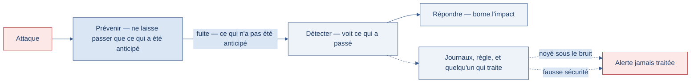

[← Chapitre précédent](11-attaques-authentification.md) · [Sommaire](Readme.md) · [Chapitre suivant →](13-tests-intrusion.md)

# Prévention et détection — Prévenir, détecter, répondre

> Une compromission passe inaperçue pendant des mois — les rapports publics sur
> les fuites de données s'accordent sur des durées moyennes de l'ordre de deux
> cents jours entre l'intrusion et sa découverte. La question n'est donc pas
> « comment ne jamais être attaqué », mais « comment s'en rendre compte vite ».
> Prévenir, détecter, répondre : les trois temps de la défense, et aucun ne
> remplace les deux autres.

**Durée de lecture :** 30 min (noyau exigé, atelier compris) · **Aller plus
loin :** +15 min (facultatif, pas exigé pour finir la journée) · **Prérequis :**
les chapitres « La kill chain » et « Attaques appliquées »

---

## Objectifs

À l'issue de ce chapitre, vous serez capable de :

- **Associer** à une étape de la kill chain les mesures de prévention et de
  détection qui la couvrent.
- **Choisir** les événements à journaliser pour rendre une attaque visible.
- **Distinguer** une alerte exploitable d'un bruit de journal.
- **Rédiger** les premiers gestes d'une réponse à incident.

---

## I. Prévenir

Prévenir, c'est rendre l'attaque difficile ou inintéressante. Les mesures ont
déjà été croisées au fil de la journée « Vulnérabilités applicatives » — ce qui
change ici, c'est le point de vue : on ne les classe plus par famille de
faille, mais par **étape de la chaîne d'attaque** qu'elles coupent.

| Étape visée | Mesures de prévention | Effet recherché |
| --- | --- | --- |
| Reconnaissance | réduire la surface exposée, retirer les pages et services inutiles | donner moins d'informations |
| Accès initial | mises à jour, requêtes paramétrées, échappement des sorties, authentification forte | fermer les portes d'entrée connues |
| Escalade | moindre privilège, comptes de service séparés | limiter ce qu'un accès permet |
| Mouvement latéral | segmentation, cloisonnement des environnements | empêcher de passer d'un système à l'autre |
| Persistance | contrôle des tâches planifiées et des comptes créés | rendre le retour visible |
| Exfiltration | chiffrement, limitation des volumes sortants, minimisation des données | réduire ce qui peut sortir utilement |

Deux remarques sur ce tableau. La **minimisation des données** est la mesure
la plus sous-estimée : des données qu'on ne détient pas ne peuvent pas être
volées — conserver des adresses de courriel dix ans après la fin de la
relation client expose dix ans de risque inutile, et le **RGPD** (Règlement
général sur la protection des données) en fait une obligation. Et la
prévention a une **limite structurelle** : elle porte sur ce qu'on a anticipé.
Une faille inconnue, un usage détourné d'une fonction légitime, un accès
interne mal intentionné passent au travers — c'est pour cela que la détection
n'est pas un complément de confort.

Le schéma ci-dessous montre la fuite au lieu de la raconter : la prévention ne laisse passer que ce qui a été anticipé, et la détection récolte le reste.



> [!TIP]
> Une mesure de prévention se choisit par ce qu'elle coupe dans la chaîne, pas
> par sa sophistication. Un compte de base de données aux droits minimaux coupe
> l'extraction ; c'est souvent plus efficace qu'un outil supplémentaire.

---

## II. Détecter

Détecter, c'est rendre l'attaque **visible**. Trois ingrédients sont nécessaires :
des journaux qui contiennent l'information, une règle qui la repère, et quelqu'un
qui traite l'alerte.

### Ce qui mérite d'être journalisé

Un journal (*log*) utile répond à la question « qui a fait quoi, quand, et
depuis où ? ». Pour une application web, le minimum comprend :

- les **connexions** — réussies et échouées, avec l'identifiant et l'adresse
  d'origine ;
- les **changements de droits** — élévation de privilège, création de compte,
  modification de rôle ;
- les **accès aux données sensibles** — exports, lectures volumétriques ;
- les **erreurs techniques** — en particulier celles qui révèlent la structure
  interne ;
- les **changements de configuration** — activation d'un mode debug, ouverture
  d'une route.

> 🧪 **Atelier rapide (5 min)**
>
> Sur le service `vulnerable` du lab local, déclenchez une injection depuis la
> recherche, puis consultez les journaux du conteneur :
>
> ```bash
> curl "http://localhost:8080/products/search?q=' OR '1'='1"
> docker logs lab-vulnerable
> ```
>
> Observez ce qui apparaît : la requête est-elle journalisée ? La saisie
> l'est-elle ? Une erreur est-elle visible ? Notez ce qui manque pour qu'un
> analyste puisse comprendre l'événement **après coup**.

Ce que montre ce test est fréquent : la requête est souvent journalisée, la
**suspicion** rarement. Un journal qui enregistre tout sans rien signaler force
l'analyste à relire des milliers de lignes — c'est le bruit, pas la détection.

### Ce qui fait une alerte exploitable

Une alerte utile contient assez de contexte pour être **traitée sans
investigation préalable** : quoi, quand, qui, depuis où, et ce qui a été touché.
Une alerte qui dit « erreur 500 » n'est pas une alerte : c'est un symptôme.

Les signaux les plus rentables sont souvent les plus simples :

- une série d'échecs de connexion sur un même compte ;
- une connexion depuis un pays ou une plage horaire inhabituelle ;
- un volume de lecture de données hors norme ;
- l'apparition d'un compte ou d'une tâche planifiée inconnue.

> [!WARNING]
> La détection sans traitement est une fausse sécurité. Si personne ne lit les
> alertes, ou si aucune procédure ne dit quoi en faire, la journalisation ne
> réduit pas la durée de compromission — elle la documente.

---

## III. Répondre

Répondre, c'est limiter les dégâts puis rétablir un fonctionnement sûr. Les
plans d'incident détaillés sont approfondis en fin de parcours ; les premiers
gestes, eux, se connaissent dès maintenant :

1. **Conserver** — ne pas effacer les traces avant de les avoir capturées : les
   journaux, les captures, l'état des systèmes touchés.
2. **Isoler** — couper l'accès de ce qui est compromis, sans pour autant
   détruire la preuve ni arrêter un service critique sans arbitrage.
3. **Qualifier** — ce qui a été atteint, ce qui a pu être lu ou copié, depuis
   quand.
4. **Informer** — la direction, les personnes concernées, et le cas échéant
   l'autorité de protection des données : le RGPD impose une notification en cas
   de violation de données personnelles, dans un délai court.
5. **Corriger et vérifier** — traiter la cause racine, pas seulement le
   symptôme, puis confirmer que l'attaque ne peut plus être rejouée.

L'ordre compte : isoler avant de comprendre fait parfois plus de dégâts que
l'attaque elle-même, et effacer « pour nettoyer » détruit ce qui permettrait de
savoir ce qui s'est passé.

### Exercice 1 — Écrire une analyse menace / prévention (55 min)

#### Contexte

La société **Altis Data** exploite une plateforme de reporting : une API
(*application programming interface*) alimente un tableau de bord consulté par
les responsables de magasins. Les points d'entrée sont notés avec leur verbe HTTP (protocole de transfert hypertexte) — GET (lecture) et POST (envoi de données). La plateforme expose les points d'entrée suivants :

| Point d'entrée | Rôle | Qui y accède |
| --- | --- | --- |
| `POST /login` | ouverture de session | tous les utilisateurs |
| `GET /reports` | consultation des rapports | utilisateurs connectés |
| `GET /reports/export` | export des données de vente | utilisateurs connectés |
| `GET /admin/users` | gestion des comptes | administrateurs |
| `GET /debug/config` | diagnostic technique | équipe technique |

L'équipe vient de mettre la plateforme en production. Personne n'a encore écrit
ce qui pourrait mal tourner, ni ce qui permettrait de le voir arriver : c'est
votre travail.

---

#### Consignes

##### Partie 1 — Cartographier les menaces

Listez **six scénarios d'attaque** plausibles sur cette plateforme. Pour chacun,
donnez :

- le scénario, en une phrase concrète (qui fait quoi, et ce qu'il obtient) ;
- l'étape de la kill chain concernée (accès initial, escalade, mouvement
      latéral, exfiltration…) ;
- le point d'entrée impliqué parmi ceux du tableau ci-dessus.

Visez la variété : tous les scénarios ne doivent pas passer par le même point
d'entrée ni par la même étape de la chaîne.

##### Partie 2 — Prévenir et détecter

Complétez votre cartographie avec deux colonnes :

- **prévention** : la mesure qui coupe le scénario, formulée comme une action
  (« paramétrer la requête », « limiter le débit »…) ;
- **détection** : l'événement qui rendrait le scénario visible, formulé comme
  une information journalisée (« série d'échecs de connexion sur un même
  compte »…).

Une mesure peut couvrir plusieurs scénarios : signalez-le plutôt que de la
recopier.

##### Partie 3 — Répondre et prioriser

Parmi vos six scénarios, choisissez celui que vous traiteriez **en premier**.
Justifiez votre choix avec un critère explicite (exposition, données touchées,
nombre de personnes concernées, difficulté de détection…).

Puis écrivez les **premiers gestes de réponse** pour ce scénario, dans l'ordre,
en vous appuyant sur les cinq temps du cours (conserver, isoler, qualifier,
informer, corriger).

---

#### ✅ Auto-évaluation

Avant de passer au corrigé, vérifiez que :

- [ ] J'ai **six** scénarios, et ils ne passent pas tous par le même point
      d'entrée.
- [ ] Chaque scénario est rattaché à une **étape de la kill chain** nommée.
- [ ] Chaque scénario a **les deux colonnes** : prévention **et** détection.
- [ ] Ma priorité affiche un **critère explicite**, pas seulement un classement.
- [ ] Mes premiers gestes de réponse suivent un **ordre**, et commencent par la
      conservation des traces.

---

#### Prolongement de l'exercice

*Facultatif.* Parmi vos mesures de détection, laquelle déclencherait le plus
d'alertes sans être la plus utile ? Expliquez en quelques lignes comment vous
réduiriez ce bruit sans perdre le signal.

<details>
<summary>Voir la correction</summary>

> Comparez d'abord votre travail aux **étapes** ci-dessous : la méthode compte autant que le résultat. Les scénarios proposés sont un **modèle** — d'autres choix se défendent, à condition d'être justifiés.

#### Partie 1 — Cartographier les menaces

**Éléments attendus :** une cartographie variée, qui ne tourne pas tous autour
du même point d'entrée. Les verbes HTTP (protocole de transfert hypertexte) sont rappelés — GET (lecture) et POST (envoi de données). Modèle de référence :

| Scénario | Étape de la kill chain | Point d'entrée |
| --- | --- | --- |
| Un script rejoue des couples identifiant / mot de passe volés ailleurs jusqu'à trouver un compte valide | accès initial | `POST /login` |
| Une période de rapport mal filtrée fait réécrire la requête de données et renvoie plus que prévu | accès initial | `GET /reports` |
| Un utilisateur connecté tape l'adresse de gestion des comptes et obtient la liste des comptes | escalade de privilèges | `GET /admin/users` |
| Une page de diagnostic, laissée active, affiche les identifiants de connexion à la base de données | accès initial (appui) | `GET /debug/config` |
| Un compte légitime exporte l'historique complet des ventes en une seule opération | exfiltration | `GET /reports/export` |
| Un script déposé dans un contenu affiché vole le cookie de session d'un responsable | accès initial | `GET /reports` |

**Ce qu'il faut retenir :** la variété est l'objectif de cet exercice. Une
cartographie où les six scénarios passent par le formulaire de connexion rate
les risques les plus coûteux — ceux qui viennent des comptes déjà légitimes et
des fonctions déjà autorisées.

**Erreurs fréquentes :** décrire des conséquences (« la plateforme est
piratée ») au lieu de scénarios. Un scénario se décrit par **qui fait quoi, par
quel bouton, et ce qu'il obtient** — sinon il n'est pas actionnable.

---

#### Partie 2 — Prévenir et détecter

**Éléments attendus :**

| Scénario | Prévention | Détection |
| --- | --- | --- |
| Credential stuffing | limite de débit sur `POST /login`, MFA (authentification multi-facteurs), message d'erreur unique | série d'échecs de connexion sur un même compte, ou depuis une même adresse sur plusieurs comptes |
| Injection dans le rapport | requête paramétrée, échappement des sorties | erreur technique sur la génération de rapport, requête avec un motif inhabituel |
| Contournement de `/admin/users` | contrôle de rôle vérifié **côté serveur**, sur chaque route | accès à une route d'administration par un compte non administrateur |
| Fuite de `/debug/config` | désactiver le mode diagnostic en production, ne jamais y mettre d'identifiants | toute consultation de la route de diagnostic en production |
| Export volumétrique | plafond de volume par export, justification métier, chiffrement du fichier exporté | export dont le volume sort de l'habitude du compte |
| Vol de session | cookie `HttpOnly` et `Secure`, HTTPS, expiration courte | même session utilisée depuis deux endroits différents |

**Ce qu'il faut retenir :** la colonne « détection » est la plus souvent oubliée,
et c'est elle qui transforme une analyse en outil de travail. Une mesure de
prévention qui échoue n'est pas une défaite si le scénario devient visible —
c'est même le cas nominal d'une défense en profondeur.

**Erreurs fréquentes :** écrire « journaliser les requêtes » comme détection.
C'est une collecte, pas une détection : l'information doit être **comparée à une
habitude** ou à une règle pour devenir un signal.

---

#### Partie 3 — Répondre et prioriser

**Éléments attendus** (le choix varie — c'est le critère qui est attendu) :

Deux priorités se défendent pour **Altis Data** :

- la **fuite de `/debug/config`**, si l'on juge sur l'exposition : des
  identifiants de base de données ouvrent l'accès à tout le reste, sans laisser
  de trace dans l'application ;
- l'**export volumétrique**, si l'on juge sur les données touchées : c'est le
  scénario qui met le plus de données personnelles entre de mauvaises mains, et
  le RGPD en fait un risque à traiter en priorité.

Ce qui est attendu, c'est que le critère soit **dit** : un classement sans
critère affiché ne se discute pas.

**Premiers gestes de réponse**, dans l'ordre :

1. **Conserver** — capturer les journaux de l'application, de la base et du
   réseau sur la période concernée, avant toute modification.
2. **Isoler** — révoquer les identifiants ou les sessions concernés, couper
   l'accès en cause, sans arrêter la plateforme pour les autres utilisateurs.
3. **Qualifier** — établir ce qui a été lu ou copié, depuis quand, et par quel
   compte.
4. **Informer** — la direction, l'équipe technique, et si des données
   personnelles sont concernées, l'autorité de protection des données et les
   personnes, dans les délais prévus par le RGPD.
5. **Corriger et vérifier** — traiter la cause racine (pas seulement la route
   en cause), puis confirmer que le scénario ne peut plus être rejoué.

**Ce qu'il faut retenir :** la réponse commence par **conserver**, pas par
nettoyer. L'instinct consiste à rétablir le service au plus vite ; c'est
souvent ce qui détruit les seules traces permettant de savoir ce qui a été
exfiltré — et donc de savoir quoi annoncer.

---

#### Points à retenir

- Une analyse menace / prévention se lit comme un **tableau de travail** :
  scénario, étape de la chaîne, prévention, détection.
- La **variété des scénarios** compte plus que leur nombre : les comptes
  légitimes et les fonctions déjà autorisées sont des voies d'accès à part
  entière.
- La détection transforme une analyse en outil : une prévention qui échoue et
  qui se voit reste une défense.
- Une priorité n'a de valeur que si son **critère est explicite**.
- La réponse à incident suit un ordre — conserver, isoler, qualifier, informer,
  corriger — et le premier geste est la conservation des traces.

</details>

---

## IV. Aller plus loin

*Contenu facultatif, pas exigé pour finir la journée : ces approfondissements
ne sont jamais exigés pour terminer le cours.*

- **EDR et XDR** : l'EDR (*Endpoint Detection and Response*) surveille les postes et
  serveurs (processus, fichiers, connexions) ; le XDR (*eXtended Detection and
  Response*) corrèle ces signaux avec ceux du réseau, des identités et du cloud.
  Ce sont les outils d'un centre de sécurité, le SOC (*Security Operations
  Center*) — utiles quand le volume de journaux dépasse ce qu'une équipe peut
  lire.
- **La détection comportementale** : plutôt que de chercher une signature
  connue, elle repère ce qui s'écarte d'une habitude — un compte qui lit des
  données qu'il n'a jamais lues. Plus difficile à calibrer, plus efficace contre
  les attaques inconnues.
- **Les exercices de crise** : un plan d'incident non testé se déroule rarement
  comme prévu. Un exercice court, une fois par an, révèle les points de blocage
  avant l'incident réel.

---

## Points clés

- La défense a trois temps — **prévenir, détecter, répondre** — et aucun ne
  remplace les deux autres.
- La prévention coupe des étapes connues de la chaîne ; la **détection** couvre
  ce que la prévention n'a pas anticipé.
- Un journal utile répond à « qui a fait quoi, quand, depuis où » ; une alerte
  utile contient assez de contexte pour être traitée telle quelle.
- La **minimisation des données** réduit le risque à la source : ce qu'on ne
  détient pas ne peut pas fuiter.
- Les premiers gestes de réponse suivent un ordre : conserver, isoler, qualifier,
  informer, corriger — et vérifier que la cause racine a bien été traitée.

---

## 🧠 Vérifiez vos acquis

*Formatif, jamais noté. Répondez sans relire le chapitre, puis dépliez « Vérifier ses réponses » pour vous corriger : ce qui compte est de repérer où vous vacillez, pas de faire 5 sur 5.*

**1.** Une faille inconnue, un usage détourné d'une fonction légitime, un accès interne mal intentionné : que montre ce trio ?

- A. Que la prévention est inefficace et qu'il faut tout reporter sur la réponse, quitte à corriger après coup
- B. Que la prévention a une limite structurelle : elle porte sur ce qui a été anticipé — la détection n'est donc pas un complément de confort
- C. Qu'il faut journaliser davantage d'erreurs techniques pour finir par corriger ce type de faille
- D. Que la minimisation des données est sans effet sur ces trois cas, puisqu'ils viennent d'un usage normal

**2.** Un service commercial conserve depuis dix ans les adresses de courriel d'anciens clients. Quelle mesure le chapitre met-il en avant, et pourquoi ?

- A. Le chiffrement au repos, puisque les données sont déjà là et qu'il ne reste qu'à les protéger
- B. La journalisation des accès à cette table, pour voir qui les consulte et depuis où
- C. La minimisation des données : ce qu'on ne détient pas ne peut pas être volé, et le **RGPD** (Règlement général sur la protection des données) en fait une obligation
- D. La segmentation du réseau, qui empêche la sortie des données vers un stockage étranger

**3.** Laquelle de ces alertes est exploitable, au sens du chapitre ?

- A. « Erreur 500 sur la route /products/search, 340 occurrences depuis 09:12 »
- B. « 47 tentatives de connexion échouées sur le compte a.durand, entre 02:10 et 02:14, depuis 203.0.113.7 »
- C. « Service démarré à 06:00, 12 dépendances chargées, aucune erreur au démarrage »
- D. « Journalisation des requêtes activée sur toutes les routes, niveau info »

**4.** Un incident vient d'être découvert sur un serveur. Quel est le premier geste, tel que le chapitre ordonne les réponses ?

- A. Isoler la machine, immédiatement
- B. Corriger la cause racine pour bloquer le rejeu
- C. Conserver les traces avant de les avoir capturées
- D. Informer l'autorité de protection des données

**5.** *Question ouverte (2-3 lignes).* Citez trois catégories d'événements que le chapitre place dans le minimum à journaliser pour une application web, et expliquez le piège d'un journal « qui enregistre tout sans rien signaler ».

---

<details>
<summary>Vérifier ses réponses</summary>

### Réponses

**1. B.** La prévention ne couvre que ce qu'on a anticipé : les trois cas passent au travers de ses mailles.
**Pourquoi :** c'est la raison pour laquelle la défense a trois temps — prévenir, détecter, répondre — et qu'aucun ne remplace les deux autres.

**2. C.** C'est la mesure la plus sous-estimée : conserver ces adresses dix ans après la fin de la relation client fait courir dix ans de risque inutile.
**Pourquoi :** réduire ce qui peut sortir utilement agit à la source, là où le chiffrement ou la segmentation laissent les données présentes.

**3. B.** Elle porte quoi, quand, qui, depuis où : elle peut être traitée sans investigation préalable.
**Pourquoi :** « erreur 500 » est un symptôme, pas une alerte — et le chapitre prévient que la détection sans traitement est une fausse sécurité : elle documente la durée de compromission au lieu de la réduire.

**4. C.** Conserver d'abord : journaux, captures, état des systèmes touchés.
**Pourquoi :** isoler avant de comprendre peut faire plus de dégâts que l'attaque, et effacer « pour nettoyer » détruit ce qui permettrait de savoir ce qui s'est passé. Vient ensuite isoler, qualifier, informer, puis corriger et vérifier.

**5.** Attendu, trois parmi : les connexions réussies et échouées (avec identifiant et adresse d'origine) ; les changements de droits (élévation, création de compte, modification de rôle) ; les accès aux données sensibles (exports, lectures volumétriques) ; les erreurs techniques révélant la structure interne ; les changements de configuration (mode debug activé, route ouverte). Piège attendu : un journal sans règle de repérage force l'analyste à relire des milliers de lignes — c'est du bruit, pas de la détection.
**Pourquoi :** détecter demande trois ingrédients — des journaux contenant l'information, une règle qui la repère, et quelqu'un qui traite l'alerte ; la requête est souvent journalisée, la suspicion rarement.

</details>

---

[← Chapitre précédent](11-attaques-authentification.md) · [Sommaire](Readme.md) · [Chapitre suivant →](13-tests-intrusion.md)
